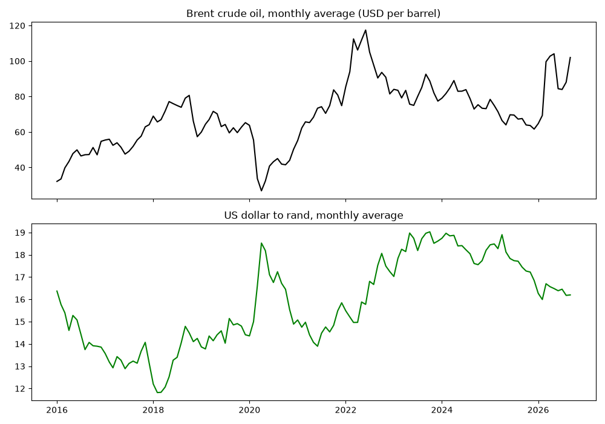
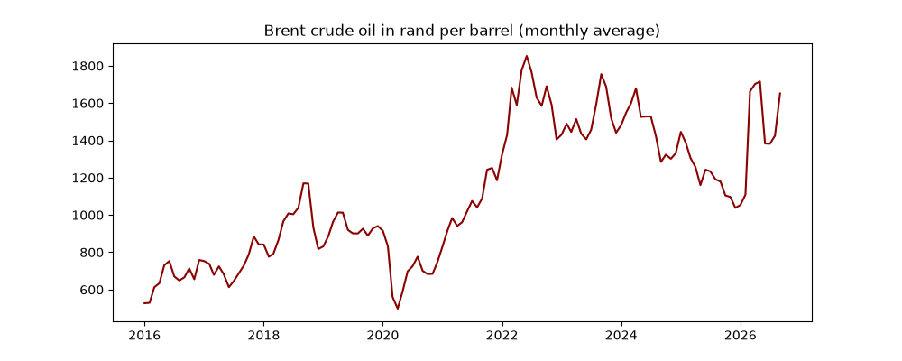
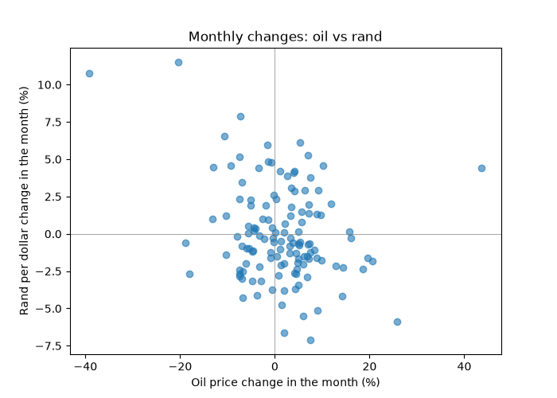
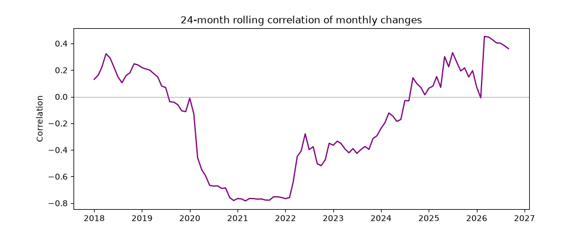

# Fuel Drivers Analysis

How have the oil price and the rand exchange rate moved together since 2016,
and what does that mean for South African fuel costs?

**Status:** analysis complete (first version)

## Key findings

1. **Price levels:** monthly average Brent crude and the USD/ZAR rate were weakly
   positively correlated (0.30) from January 2016 to September 2026.
   Both series drift over the years, so this says little about how they behave
   month to month.
2. **Monthly changes:** the correlation of month-to-month percentage changes was
   -0.27, which looks like a negative link, but it was driven almost entirely by 2020.
   Removing all of 2020 cut it to -0.01. Removing only March and April 2020 cut it to -0.10.
   From 2021 onwards (69 months) it was -0.01.
3. **Rank correlation:** a Spearman test, which is less affected by extreme months,
   gave -0.15, a faint tendency at most.
4. **The relationship is not stable:** a 24-month rolling correlation moved from
   about +0.3 in 2018, to about -0.8 in 2020 to 2021, and back to positive in 2025 to 2026.
5. **Oil is far more volatile than the rand:** the standard deviation of monthly changes
   was about 9.3% for oil and 3.2% for the rand.
6. **The rand changes what oil costs South Africa:** converting the oil price to rand
   shows the combined effect of both forces. For example, in January 2016, Brent stood at
   $32.15/bbl and the exchange rate was R16.37/$, costing South Africa R526.33 per barrel.
   By June 2022, Brent peaked at $117.46 with the rand at R15.77, driving landed crude costs
   to an all-time peak of R1,852.87 per barrel (+252% in rand terms). Even when crude eased
   back to $88.70 in October 2023, the rand weakened to a record monthly average of R19.03,
   keeping the oil price elevated at R1,687.95 per barrel.


**Extreme months:**

- **March 2020:** Brent collapsed by -39.2% amid initial pandemic lockdowns, while the rand weakened by +10.7%.
- **March 2026:** Brent rose sharply (+43.7% in the month) after the war that began on 28 February 2026
disrupted shipping through the Strait of Hormuz. The EIA reports front-month Brent
rising from $61 at the start of the year to $118 at the end of March
([EIA, 7 April 2026](https://www.eia.gov/Todayinenergy/detail.php?id=67424)).

**Answer to the question:** in this data, oil and the rand did not show a reliable
month-to-month relationship outside the 2020 shock. South African fuel costs are exposed
to both, and neither consistently offsets the other.

## Charts






## Data

Daily Brent crude futures (`BZ=F`) and USD/ZAR (`ZAR=X`) from Yahoo Finance via the
`yfinance` Python library, downloaded on 25 October 2026.

## How to run

### 1. Launch the Interactive Dashboard (Streamlit)

```bash
pip install -r requirements.txt
python -m streamlit run app.py
```

### 2. Run the Command-Line Analysis Scripts

```bash
python step3_charts.py
python step4_changes.py
```
*(Optional: run `python step2_clean.py` to refresh online daily data from Yahoo Finance)*


`step2_clean.py` downloads fresh data from Yahoo Finance and overwrites `data/monthly_oil_rand.csv`, so the numbers can differ from those reported here. To reproduce the published results, skip it and use the CSV already in `data/`.

## Method

- Selected closing prices and renamed the columns.
- Oil was missing on 99 days (market holidays) and the rand on 4. I filled gaps by
  carrying the previous day's price forward, because a closed market does not change the
  last known price. One oil value on 1 January 2016 had no earlier price, so I dropped that row.
- Converted daily prices to monthly averages (130 months), then dropped October 2026
  because it was incomplete, leaving 129 months and 128 monthly changes.
- Compared correlations of price levels and of monthly percentage changes, then tested
  how sensitive the result was by removing 2020, removing March and April 2020,
  using only 2021 onwards, and using Spearman rank correlation.

## Limitations

- **Futures prices, not spot:** `BZ=F` is a Brent futures price, not the price refineries
  pay, and futures series can show jumps when contracts roll over.
  The March 2026 jump was corroborated against EIA reports on the Strait of Hormuz conflict.
- **Pump prices were not analysed:** this project studies two inputs to the fuel price.
  South Africa's pump price also includes taxes, levies and margins, which are not
  in this data.
- **Correlation is not causation:** none of these results show that oil moves the rand,
  or the reverse.
- **One shock dominates:** a handful of months (especially March 2020) drive the
  main correlation, so the results are sensitive to the period chosen.
- **Rolling window effects:** in the 24-month rolling chart, extreme months entering
  or leaving the window cause sudden jumps. I have not tested each jump individually.
- **No formal significance testing:** I did not calculate p-values, so I describe
  weak correlations as weak and do not claim they are statistically meaningful.
- **Sample size:** about ten years of monthly data is small for a stable estimate.

## Next steps

- [ ] Add actual monthly retail petrol prices from the Department of Mineral Resources and Energy (DMRE), and test how the pump price responds to oil in rand.

 Added Pearson and Spearman p-values via `scipy.stats` in `src/analytics.py`.
- [x] **Interactive dashboard:** Built interactive Streamlit dashboard (`app.py`) with Plotly visualizations, shock toggles, and what-if simulation.

## How this was built

Built as a learning project with guidance
from an AI assistant (Claude). I wrote and ran the code, checked the outputs against
the charts, and made the cleaning and interpretation decisions.